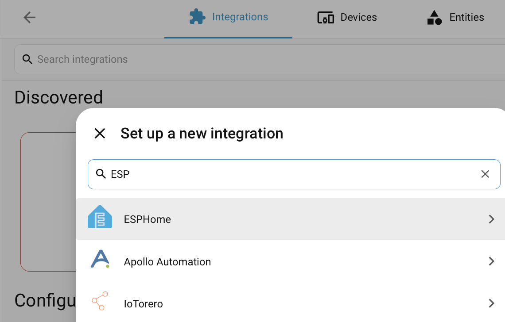
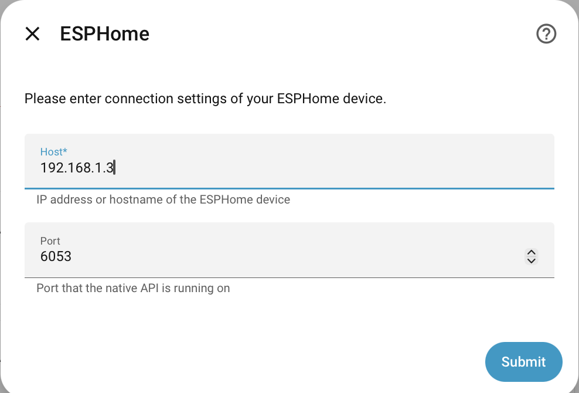
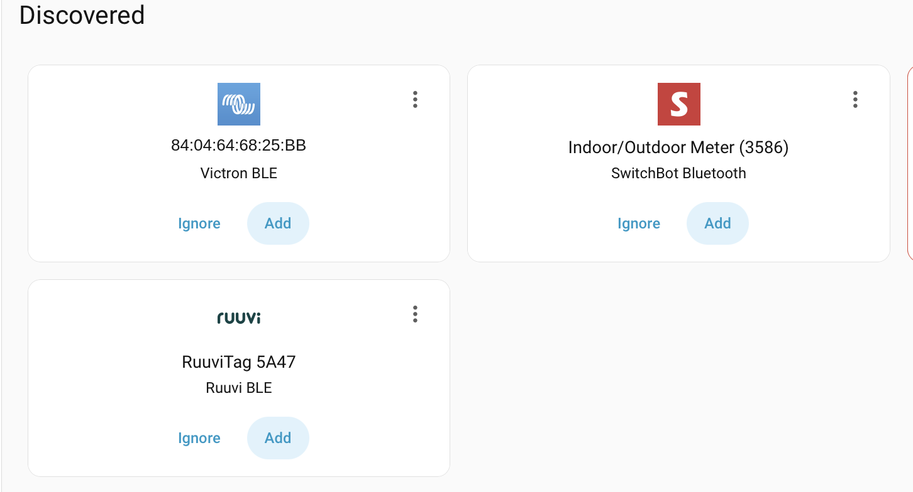
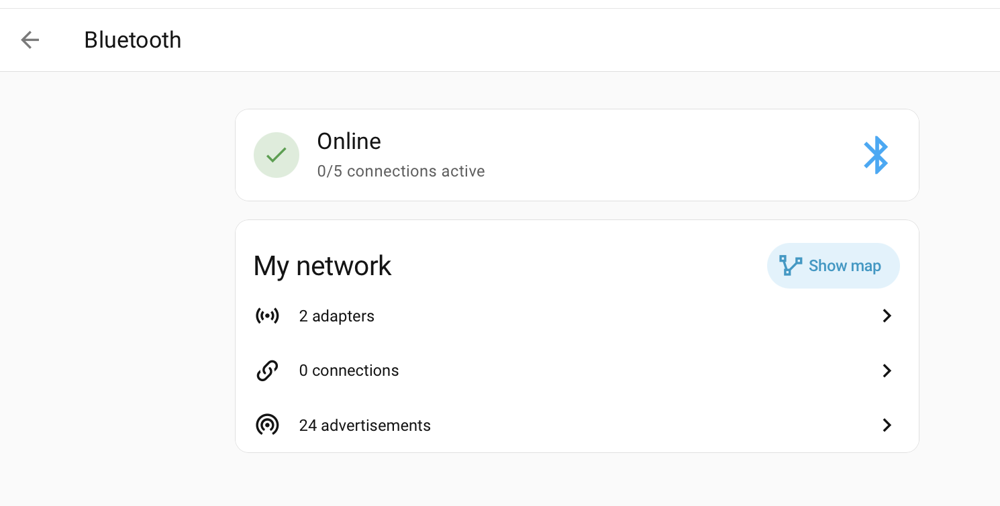

# pico-ble-proxy

A minimal Bluetooth Low Energy (BLE) proxy intended to run on a combination of an ESP32 USB stick and a tiny device like a router and act as an extension of Home Assistant's BLE support.

The original environment is a Teltonika 95X series 4G router and a $10 [Seeed XIAO ESP32-C6](https://www.seeedstudio.com/Seeed-Studio-XIAO-ESP32C6-p-5884.html) with an external 2.4 GHz antenna on a boat, with Wireguard VPN extending the home network to the boat. Typical BLE devices are Victron boxes, and thermometers such as RuuviTag and Switchbot.

> [!NOTE]
>This project is focused only on passive Bluetooth *Low Energy* usage, so it doesn't do any of the traditional Bluetooth pairing, has no audio support, and doesn't handle active BLE using GATT.

## How it Works

The *combination* of the ESP32 device and Linux daemon acts as an **ESPHome** device, so can be added to Home Assistant using the standard ESPHome integration and will show up automatically in the Bluetooth integration, along with any configured BLE devices it finds.

The ESP32 device has a Bluetooth stack, and preferably an external antenna connection, and communicates solely over the USB serial connection, from which it also gets its power.

The Linux daemon, `bleproxyd`, listens on the USB serial port for BLE traffic from the ESP32 and listens on a TCP socket for an incoming Home Assistant BLE connection.

For security and tiny footprint, it does scan and report all BLE devices found, it only forwards data from a configured list of MAC addresses (easily discoverable from any Bluetooth scanner, or from SignalK's BLE Manager, Home Assistant etc).

## Dependencies

`bleproxyd` is tiny, and has no dependencies on BlueZ, Python or packages on the router. There is no reliance on Wi-Fi, ideal for when the boat or similar is being monitored long term in a minimal power environment.

```
BLE devices ──► XIAO ESP32-C6 ──USB (CDC-ACM)──► Router bleproxyd ──WireGuard/LTE──► Home Assistant
                NimBLE scanner                    ESPHome native API :6053          homeassistant.local
                (firmware/)                       allowlist + rate limit (bleproxyd/)
```

> [!WARNING]
> Some countries take a hard line on the freedom that ESP32 devices give to tinkerers, so be careful about importing them, and you may need to domestically source devices.

## Build and Test

Find the instructions at [BUILD.md](./BUILD.md)

## Install on the Host Device

> [!NOTE]
>These instructions assume an Openwrt-based Teltonika RutOS modem/router, however it should work on any Linux based device that has USB ports.


RutOS 7.x has a read-only root. The writable overlay holds `/usr/local` and `/etc`, with under 1 MB free.

```sh
scp -O bleproxyd/dist/bleproxyd-linux-mipsle    root@192.168.1.1:/usr/local/bin/bleproxyd
scp -O bleproxyd/bleproxyd.conf.example         root@192.168.1.1:/etc/bleproxyd.conf
scp -O bleproxyd/packaging/procd/bleproxyd.init root@192.168.1.1:/etc/init.d/bleproxyd
ssh root@192.168.1.1 'chmod +x /usr/local/bin/bleproxyd /etc/init.d/bleproxyd &&
  bleproxyd check-config && /etc/init.d/bleproxyd enable && /etc/init.d/bleproxyd start &&
  sleep 3 && logread -e bleproxyd | tail'
```

An alternative service for `systemd` based hosts is available at `bleproxyd/packaging/systemd`.

### Notes
- Routers may block clients that opens several SSH connections quickly, so batch commands into one `ssh` where possible.
- With the ESP plugged in, `ls /dev/ttyACM*` should show it.
  - The host device needs the `cdc_acm` driver.
  - If nothing appears, the cable is probably power-only (often USB-C or USB-A -> USB-C cables are designed for charging purposes and not data. Often the data and power ones are advertised as 'Carplay' compatible)
- Firewall: allow TCP port 6053 from the host IP, and TCP port 4000 from home for reflashing, on whichever zone the WireGuard traffic arrives in.
  -  `bleproxyd` also enforces `allow_from` itself.
- Firmware upgrades: check whether the host OS keeps `/usr/local` and `/etc/bleproxyd.conf` across an upgrade with "keep settings". If it doesn't, reinstall afterwards.

## Add to Home Assistant



- **Settings** → **Devices & services** → **Add integration** → **ESPHome**.
- Set the IP address of the host, and port `6053` unless overridden.
- There is no encryption key.
- mDNS doesn't cross VPNs, and often not between Wifi and wired, so it won't be auto-discovered.



Once that's done, integrations like Victron BLE, Ruuvi and SwitchBot integrations discover their devices through it as usual. Some, like Victron, will need an encryption key at this stage (VictronConnect app has the Instant Readout key).



HA's Bluetooth page shows it as an active scanner with 0 connection slots. That's expected, currently this is a passive scanner only, and forwards on data that devices continually advertise to all listeners, it doesn't poke about with GATT to actively pull data, as is required for things like Bluetti power stations.



## Choosing devices

Only `device` lines in `/etc/bleproxyd.conf` are forwarded, so nearby devices (such as in a marina, campsite etc) stay off the link. To find new devices:

```sh
/etc/init.d/bleproxyd stop; bleproxyd discover -t 30; /etc/init.d/bleproxyd start
```

Each device is forwarded at most every `min_interval` (10 s) and re-sent every `keepalive` (2 min) when its payload is unchanged. Without the keepalive, HA marks passive devices unavailable after about 15 minutes of silence.

## Reflashing remotely

The C6's USB-Serial-JTAG is a hardware peripheral, so the ROM bootloader stays reachable over USB whatever the app firmware is doing. `bleproxyd flash-bridge` exposes the port as RFC 2217 (Telnet with DTR/RTS control), so stock `esptool` at home can reset the chip into the bootloader and flash it:

```sh
ESPTOOL=esptool tools/flash-remote.sh     # REMOTE=root@192.168.1.1 PORT=4000 by default
```

Plain `socat` TCP forwarding carries the data but not DTR/RTS, so esptool can't reset the chip through it. It's still handy for development: run `socat TCP-LISTEN:7000,reuseaddr
/dev/ttyACM0,raw,echo=0` on the host, and point a laptop `bleproxyd` at `serial tcp://192.168.1.1:7000`.

To restore a backup, run `esptool write-flash 0 backups/<file>.bin`.

## Potential Extensions

- Active GATT connections (Bluetti, ESL tide clocks):
  - add the ESPHome connection and GATT messages
  - plus matching serial commands.
- Signal K: a second front end in `bleproxyd` using the same hub.
- Noise encryption on the API. WireGuard already encrypts the link.

## Alternatives

- [SMLight](https://smlight.tech) - SLZB-OS has BLE support compatible with Home Assistant's BLE proxy expectations, and has a USB->Ethernet pass-through mode.
- [Shelly](https://www.shelly.com/products/shelly-blu-gateway) - USB-A dongle, requires WiFi and only advertised as supporting Shelly BLE devices.

## References

- [Home Assistant Remote Bluetooth Adapters](https://www.home-assistant.io/integrations/bluetooth/#remote-adapters-bluetooth-proxies)
  - Also has a recommended set of ESP32 hardware with decent Bluetooth support
